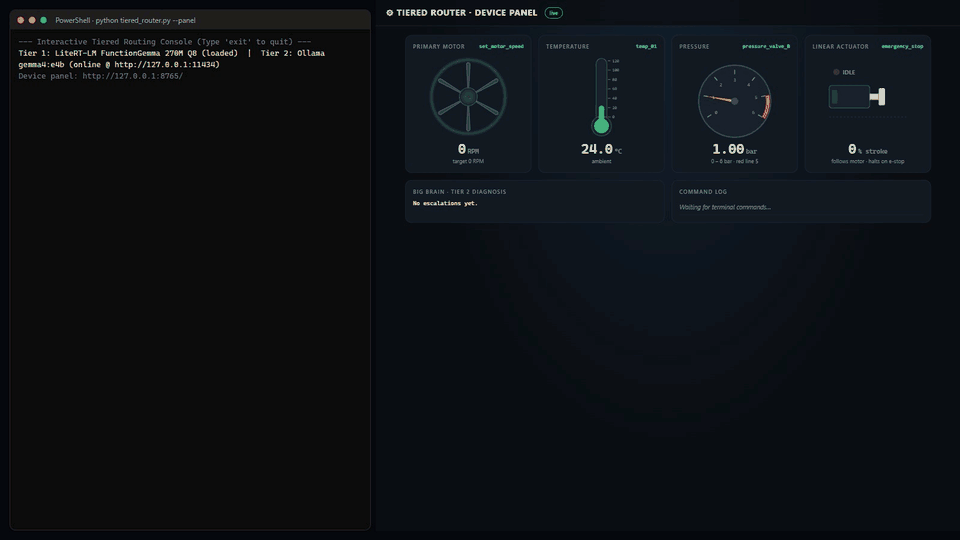

# gemma-tiered

A local "small brain / big brain" router for an industrial robot controller, running entirely on your own machine.

Routine device commands go to a tiny on-device model (**FunctionGemma 270M** via LiteRT-LM) that turns them into structured tool calls. Anything that needs reasoning, such as diagnosing a fault or writing a status report, escalates to a larger local model (**Gemma 4 E4B** via Ollama). A live browser panel shows the simulated motor, sensors and actuator reacting to each command.



<sub>The GIF replays real router outputs and latencies, but long waits are shortened (the Tier 2 report actually took 46.5 s in this recording).</sub>

## How routing works

```
prompt
  │
  ├─ diagnostic keywords? (diagnose, why, vibration, smoke, …) ──────────► Tier 2 · diagnosis
  ├─ report keywords? (report, status, summary, overview, sitrep) ───────► Tier 2 · status report
  ├─ question about device state? ("is the motor steady? what's the rpm?") ► Tier 2 · answer
  │
  ├─ Tier 1 · FunctionGemma 270M picks a tool
  │     emergency_stop / set_motor_speed / read_sensor ──────────────────► command
  │     refuses ("sorry", "cannot assist", …) ───────────────────────────► Tier 2 · diagnosis
  │
  ├─ regex fallback (model missing or no usable answer) ─────────────────► command
  └─ nothing matched ("never guess") ────────────────────────────────────► Tier 2 · diagnosis
```

| Tier | Engine | Handles | Fallback |
|---|---|---|---|
| **1 · Small Brain** | FunctionGemma 270M Q8 (LiteRT-LM, CPU, in-process) | `emergency_stop`, `set_motor_speed(rpm)`, `read_sensor(sensor_id)` | Keyword and regex matching |
| **2 · Big Brain** | `gemma4:e4b` via Ollama `/api/chat` | Diagnoses, status reports and questions about device state | States that the Big Brain is unavailable and why (offline, timeout); reports and questions also show the tracked device state |

Tier 1 never executes the tools. It returns a validated Pydantic command object. The router tracks simulated device state (motor setpoint, e-stop, sensor reads, recent commands), and that state is what Tier 2 reports and answers are based on. A question is never turned into a device action. Ollama calls time out after 90 s.

## Setup

**Requirements:** Windows, Python 3.12 and [Ollama](https://ollama.com).

```bat
setup_env.bat                         :: creates the conda env C:\aiw\envs\gemma-tiered and installs dependencies
conda activate C:\aiw\envs\gemma-tiered
python verify_env.py                  :: checks Python, packages, LiteRT and Ollama
```

**Models** (not included in the repo):

- **Tier 1:** download `mobile_actions_q8_ekv1024.litertlm` from [litert-community/functiongemma-270m-ft-mobile-actions](https://huggingface.co/litert-community/functiongemma-270m-ft-mobile-actions). The repo is gated, so you need to accept the Gemma license first. Save it to `models/functiongemma-270m/`. The path is currently hardcoded in `TieredRouter.__init__`; edit it if your checkout lives somewhere other than `C:\aiw\gemma-tiered`.
- **Tier 2:** `ollama pull gemma4:e4b`, then make sure `ollama serve` is running.

Both tiers degrade gracefully. Without the LiteRT model, Tier 1 uses regex matching. Without Ollama, Tier 2 says it is unavailable rather than inventing an answer, and reports fall back to the tracked device state. The startup line tells you which engines are active:

```
Tier 1: LiteRT-LM FunctionGemma 270M Q8 (loaded)  |  Tier 2: Ollama gemma4:e4b (online @ http://127.0.0.1:11434)
```

## Usage

```bash
python tiered_router.py                       # interactive console, plain-English output
python tiered_router.py --panel               # same, plus the live device panel in your browser
python tiered_router.py --benchmark           # 10-prompt benchmark: traffic split, P50/P95, latency saved
python tiered_router.py --debug               # raw JSON payloads instead of plain English
```

The flags can be combined, for example `--benchmark --panel --debug`.

Prompts to try:

```
Set primary motor to 1400 RPM
Read sensor temp_01
Emergency halt right now
give me a status report
is the motor steady? what is the rpm?
Why is the conveyor belt slipping whenever torque demand exceeds 45Nm?
```

## Device panel

`--panel` serves a page at `http://127.0.0.1:8765`. If that port is busy, the terminal prints the address it used instead. The page receives each routed result over Server-Sent Events.

- **Motor:** spins up or down to the commanded RPM.
- **Thermometer and pressure gauge:** readings rise with motor speed. They are simulated values, not real hardware.
- **Linear actuator:** cycles while the motor runs.
- **E-stop:** shows a flashing banner and halts everything. Commanding a new speed clears it, which is demo behavior; a real e-stop stays latched until reset.
- **Big Brain card:** shows Tier 2 diagnoses, reports and answers.
- **Command log:** lists each prompt with a T1 or T2 badge and its latency.

The panel uses only the Python standard library and a single self-contained HTML file, with no external dependencies.

## Project layout

| File | Purpose |
|---|---|
| `tiered_router.py` | Router, both tiers, device-state tracking, output formatting, benchmark, CLI |
| `device_panel.py` | Local HTTP and SSE server for the panel |
| `panel.html` | Panel UI (inline SVG and JavaScript) |
| `setup_env.bat`, `verify_env.py` | Environment setup and checks |
| `tools/record_demo.py` | Regenerates `docs/demo.gif` (needs `pip install playwright pillow` and Chrome) |

## Known limitations

- **Tier 1 latency:** about 700–900 ms per call on CPU, well above the 20 ms target in the benchmark table.
- **Tier 2 latency:** about 25–50 s with `gemma4:e4b` on the development machine, far above the 200–500 ms target.
- **Model fit:** FunctionGemma here is the *mobile actions* fine-tune, not one trained on industrial commands, so the keyword checks and the regex fallback do part of the work.
- **Loose matching:** the keyword checks use substring matching, so for example "nonstop" counts as `stop`.
